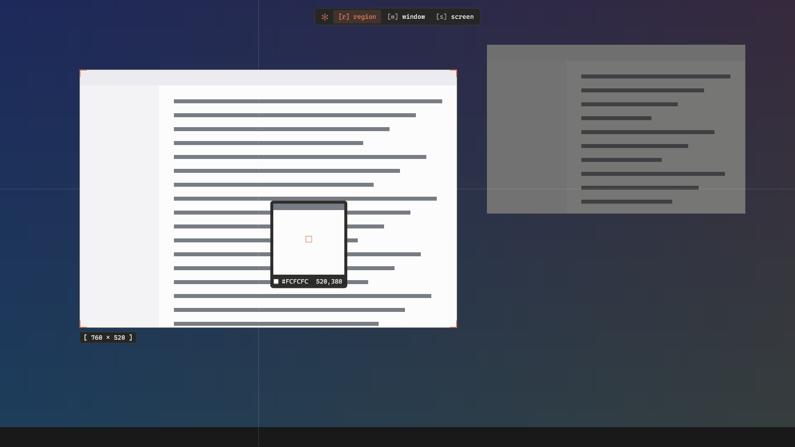
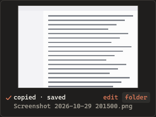

<p align="center"></p>

# oh-snap

A fast screen snipping tool for Windows, written in Rust. It replaces Snipping Tool for PrtSc, Win+Shift+S and `ms-screenclip:` links. The program is one file of about 0.5 MB.



## Install

Run this line in PowerShell. You do not need admin rights.

```powershell
irm https://raw.githubusercontent.com/codepawl/oh-snap/main/install.ps1 | iex
```

The installer puts oh-snap in `%LOCALAPPDATA%\Programs\oh-snap`, adds it to your PATH and the Start menu, and starts it at sign-in. To give the shortcuts back to Snipping Tool, run `oh-snap uninstall`.

oh-snap runs on Windows 10 and 11. macOS and Linux are not supported yet.

## Use

| Action | Result |
| --- | --- |
| PrtSc or Win+Shift+S | Opens the overlay |
| Drag | Snips a region |
| Click | Snips the window under the pointer. In `screen` mode, it snips the monitor |
| `r` `w` `s` | Switches to region, window or screen mode |
| Arrow keys | Move the pointer 1 px. Hold Shift to move 10 px |
| Enter | Snips what is highlighted, or the whole monitor |
| Esc or right click | Cancels |

A snip plays a short shutter sound. It goes to the clipboard as a bitmap and as PNG, and to `Pictures\Screenshots`, the folder that Windows and Photos use. A card in the corner shows the snip and the file name. Click the card to open the image, or click `folder` to show the file in Explorer.



## Compared with Snipping Tool

Measured with `oh-snap bench compare 6` on Windows 11 build 26300, two 1920x1080 monitors, an RTX 3060 and Snipping Tool 11.2608.41.0. Both tools start from a command: oh-snap from `oh-snap capture`, Snipping Tool from `ms-screenclip:`. "Screen dims" is the time until the screen image itself gets darker.

| | oh-snap | Snipping Tool |
| --- | --- | --- |
| Overlay window shows (median) | 22 ms | 286 ms |
| Screen dims (median) | 44 ms | 309 ms |
| First snip after start | 47 ms | 801 ms |
| Memory, working set | 84 MB in 1 process | 392 MB in 2 processes |
| Size on disk | 0.5 MB | 586 MB |

Run the same test on your computer with `oh-snap bench compare`. It opens and closes both overlays a few times.

## Commands

```text
oh-snap                      start in the tray
oh-snap install              install for this user and take the shortcuts
oh-snap uninstall            give the shortcuts back to Snipping Tool
oh-snap capture [region|window|screen] [--rect X,Y,W,H] [--out FILE] [--no-clipboard] [--no-save]
oh-snap bench [ROUNDS]       measure capture and overlay speed
oh-snap bench compare [N]    race Snipping Tool
oh-snap preview DIR          draw the overlay and the card over a fake desktop into PNG files
oh-snap logo DIR             write the logo as SVG, PNG and ICO
oh-snap quit                 stop the tray process
```

Other apps and scripts can start a snip with `oh-snap capture` or an `oh-snap://capture/window` link.

## Build

```text
cargo build --release
```

On the `x86_64-pc-windows-gnu` toolchain, `windows-rs` needs a `dlltool` that works. The one that Rust ships needs `as.exe`, which is not included. Run `rustup component add llvm-tools`, then put a copy of `llvm-ar.exe` named `dlltool.exe` on PATH. The MSVC toolchain does not need this step.

## How it works

- `capture.rs` keeps one DXGI Desktop Duplication for each monitor. It keeps the latest frame in video memory, so a snip reads back only once.
- `overlay.rs` draws the frozen desktop with Direct2D at 1 unit for 1 physical pixel. The process is per-monitor DPI aware, so mixed-DPI setups line up.
- `daemon.rs` uses a low-level keyboard hook to get Win+Shift+S and PrtSc before Explorer does. Win+PrtSc and Alt+PrtSc stay with Windows.
- `card.rs` shows the result without taking the focus. `sound.rs` makes the shutter sound in code, so no audio file ships.
- `install.rs` writes only to `HKCU` and keeps the old PrtSc setting, so `uninstall` can restore it.

## Known limits

- The tray process holds an open capture device so the overlay is fast. This costs about 40 MB at start and about 84 MB after the first snip, which the GPU driver keeps. The number stays flat after more snips.
- The release file is not code-signed yet. Smart App Control or SmartScreen can block it on some computers.
- Windows does not let a normal process get keys while an elevated window has focus. In that case, use the tray icon.
- Protected video (DRM) shows as black, and the UAC prompt cannot be captured.
- Rotated monitors and HDR monitors are not tested yet.

## Next

- An editor for the snip: arrows, boxes, text, blur and crop.
- Add-ons that run as their own process and get each snip, such as OCR or upload.
- macOS and Linux versions.

## License

MIT
