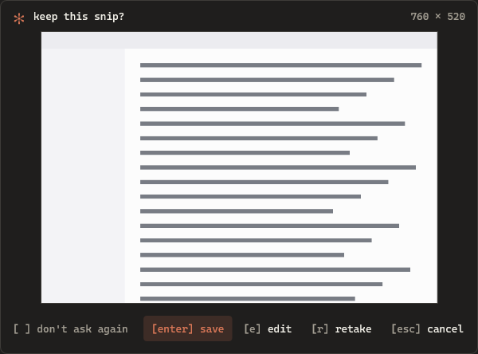
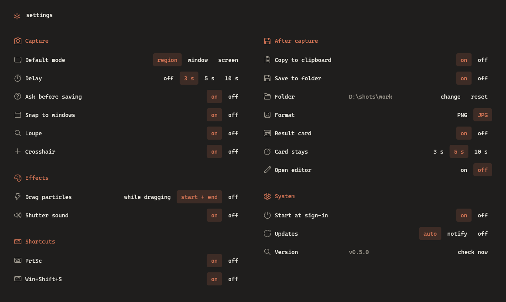
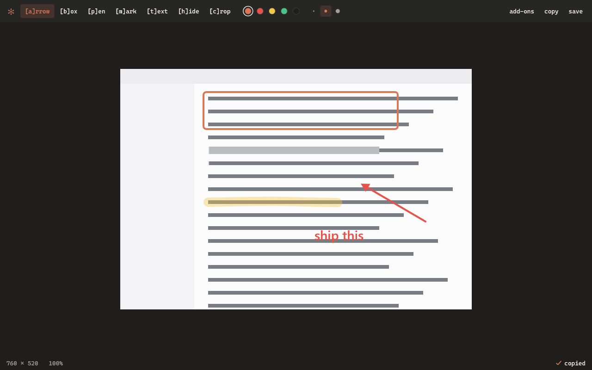

<p align="center"></p>

# oh-snap

A fast screen snipping tool for Windows, written in Rust. It replaces Snipping Tool for PrtSc, Win+Shift+S and `ms-screenclip:` links. The program is one file of about 0.8 MB.


## Install

Run this line in PowerShell. You do not need admin rights.

```powershell
irm https://raw.githubusercontent.com/codepawl/oh-snap/main/install.ps1 | iex
```

The installer puts oh-snap in `%LOCALAPPDATA%\Programs\oh-snap`, adds it to your PATH and the Start menu, and starts it at sign-in. To give the shortcuts back to Snipping Tool, run `oh-snap uninstall`.

You can also download `oh-snap.exe` from [GitHub Releases](https://github.com/codepawl/oh-snap/releases) and run `oh-snap install`, or build it with Cargo:

```text
cargo install --git https://github.com/codepawl/oh-snap
oh-snap install
```

oh-snap runs on Windows 10 and 11. macOS and Linux versions are coming.

## Use

| Action | Result |
| --- | --- |
| PrtSc or Win+Shift+S | Opens the overlay |
| Drag | Snips a region |
| Click | Snips the window under the pointer. In `screen` mode, it snips the monitor |
| `r` `w` `s` | Switches to region, window or screen mode |
| Arrow keys | Move the pointer 1 px. Hold Shift to move 10 px |
| Enter | Snips what is highlighted, or the whole monitor |
| Esc or right click | Cancels |

While you drag, bits of the screen break off the pointer like mined blocks and fall away.

After you pick an area, oh-snap asks if you want to keep it. Press Enter to save, `e` to edit first, `r` to take it again, or Esc to cancel. If you want speed, tick "don't ask again" and every snip saves at once.



## Settings

Open the settings from the tray menu or with `oh-snap settings`. A change saves at once.



| Group | Settings |
| --- | --- |
| Capture | Default mode, delay of 3, 5 or 10 seconds, ask before saving, snap to windows, loupe, crosshair |
| Effects | Drag particles: while dragging, at the start and end of the drag, or off. Shutter sound |
| Shortcuts | PrtSc, Win+Shift+S |
| After capture | Copy to clipboard, save to folder, folder, PNG or JPG, result card and how long it stays, open the editor |
| System | Start at sign-in, updates: install on their own, only tell you, or off. `check now` looks at once |

The settings live in `%APPDATA%\oh-snap\settings.toml`.

A snip plays a short shutter sound. It goes to the clipboard as a bitmap and as PNG, and to `Pictures\Screenshots`, the folder that Windows and Photos use. A card in the corner shows the snip and the file name. Click the card to open the image. Click `edit` to draw on it, or `folder` to show the file in Explorer.


## Edit

The editor opens from the card, from `oh-snap edit FILE`, or from "Edit with oh-snap" when you right-click a PNG in Explorer.



| Key | Tool |
| --- | --- |
| `a` | Arrow |
| `b` | Box |
| `p` | Pen |
| `m` | Highlighter |
| `t` | Text. Click, type, then press Enter. Shift+Enter starts a new line |
| `h` | Hide: pixelates the area, for passwords and names |
| `c` | Crop |
| `1` to `5` | Colour |

Ctrl+Z undoes and Ctrl+Y redoes. Ctrl+C copies the edited snip and Ctrl+S saves it over its file. If you close the window with unsaved edits, oh-snap asks first.

## Add-ons

An add-on is a folder with an `addon.toml` and any program. oh-snap gives it the snip as a PNG. The add-on gives back text for the clipboard, a new image, a link to open, or a message. Run one from the `add-ons` menu in the editor.

Two add-ons come with oh-snap:

- **Copy text** reads the text in the snip with the OCR engine that ships with Windows. Nothing is downloaded.
- **Copy as data URI** copies the snip as a `data:image/png;base64,` link for HTML, CSS or Markdown.

To write your own, see [docs/addons.md](docs/addons.md).

## Compared with Snipping Tool

Measured with `oh-snap bench compare 6` on Windows 11 build 26300, two 1920x1080 monitors, an RTX 3060 and Snipping Tool 11.2608.41.0. Both tools start from a command: oh-snap from `oh-snap capture`, Snipping Tool from `ms-screenclip:`. "Screen dims" is the time until the screen image itself gets darker.

| | oh-snap | Snipping Tool |
| --- | --- | --- |
| Overlay window shows (median) | 22 ms | 286 ms |
| Screen dims (median) | 44 ms | 309 ms |
| First snip after start | 47 ms | 801 ms |
| Memory, working set | 84 MB in 1 process | 392 MB in 2 processes |
| Size on disk | 0.8 MB | 586 MB |

Run the same test on your computer with `oh-snap bench compare`. It opens and closes both overlays a few times.

## Commands

```text
oh-snap                      start in the tray
oh-snap install              install for this user and take the shortcuts
oh-snap uninstall            give the shortcuts back to Snipping Tool
oh-snap capture [region|window|screen] [--rect X,Y,W,H] [--out FILE] [--no-clipboard] [--no-save]
oh-snap edit FILE            open a PNG in the editor
oh-snap addons [list]        show the add-ons
oh-snap addons add FOLDER    copy an add-on folder in
oh-snap addons remove NAME   delete an add-on
oh-snap addons run NAME FILE run an add-on on a PNG and print its result
oh-snap addons folder        print where add-ons live
oh-snap bench [ROUNDS]       measure capture and overlay speed
oh-snap bench compare [N]    race Snipping Tool
oh-snap preview DIR          draw the overlay, the card and the editor into PNG files
oh-snap logo DIR             write the logo as SVG, PNG and ICO
oh-snap settings             open the settings
oh-snap update               install the latest release from GitHub
oh-snap quit                 stop the tray process
```

oh-snap updates itself from GitHub Releases. The tray process looks for a new version 10 seconds after it starts. It downloads the new `oh-snap.exe`, checks it against the release's `SHA256SUMS.txt`, and swaps it in between snips, never in the middle of one. A card then shows the new version. Set `Updates` to `notify` to get only the card, or to `off`.

Other apps and scripts can start a snip with `oh-snap capture` or an `oh-snap://capture/window` link.

## Build

```text
cargo build --release
```

On the `x86_64-pc-windows-gnu` toolchain, `windows-rs` needs a `dlltool` that works. The one that Rust ships needs `as.exe`, which is not included. Run `rustup component add llvm-tools`, then put a copy of `llvm-ar.exe` named `dlltool.exe` on PATH. The MSVC toolchain does not need this step.

## How it works

- `capture.rs` keeps one DXGI Desktop Duplication for each monitor. It keeps the latest frame in video memory, so a snip reads back only once.
- `overlay.rs` draws the frozen desktop with Direct2D at 1 unit for 1 physical pixel. The process is per-monitor DPI aware, so mixed-DPI setups line up.
- `daemon.rs` uses a low-level keyboard hook to get Win+Shift+S and PrtSc before Explorer does. Win+PrtSc and Alt+PrtSc stay with Windows.
- `card.rs` shows the result without taking the focus. `sound.rs` makes the shutter sound in code, so no audio file ships.
- `editor.rs` and `annotate.rs` keep the edits as shapes in image pixels. The window and the export use the same drawing code.
- `addons.rs` runs each add-on as its own process without a window, and stops it after 60 seconds.
- `updater.rs` finds the latest tag from where `releases/latest` redirects, so it does not use the GitHub API and its limit of 60 calls an hour. HTTPS goes through WinHTTP and SHA-256 through CNG, both part of Windows.
- `install.rs` writes only to `HKCU` and keeps the old PrtSc setting, so `uninstall` can restore it.

## Known limits

- The tray process holds an open capture device so the overlay is fast. This costs about 40 MB at start and about 84 MB after the first snip, which the GPU driver keeps. The number stays flat after more snips.
- The release file is not code-signed yet. Smart App Control or SmartScreen can block it on some computers.
- Windows does not let a normal process get keys while an elevated window has focus. In that case, use the tray icon.
- Protected video (DRM) shows as black, and the UAC prompt cannot be captured.
- Rotated monitors and HDR monitors are not tested yet.

## Next

- Add-ons that run after every snip, not only from the editor.
- macOS and Linux versions, which are coming.

## License

MIT
